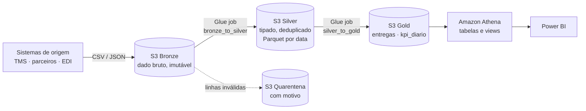

# data-lake-medallion-aws

Pipeline de dados de **entregas logísticas** em arquitetura **Medallion** (Bronze → Silver → Gold) com **PySpark** no **AWS Glue**, armazenamento em **S3** e consumo via **Amazon Athena** / **Power BI**.

> Case de portfólio escrito do zero, com **dados 100% fictícios**. Reproduz o desenho que uso em produção, sem nenhum código ou dado de empresa.


## Arquitetura



| Camada | Conteúdo | Regras |
|---|---|---|
| **Bronze** | Eventos de entrega como chegaram | Só leitura; particionado por data de ingestão |
| **Silver** | Um registro por evento, tipado | Padroniza status/UF/CNPJ, converte tipos, mantém a **última versão** de cada evento (reenvios), separa inválidos em **quarentena** com o motivo |
| **Gold** | Tabelas de negócio | `entregas`: status atual, lead time e ocorrências por entrega · `kpi_diario`: volume, % no prazo e lead time por dia/UF |

## Decisões de projeto

- **Transformações puras e testáveis** — toda a lógica fica em [`src/lakehouse/transforms.py`](src/lakehouse/transforms.py) como funções `DataFrame -> DataFrame`. Os jobs do Glue só leem, chamam a função e gravam. Assim a regra de negócio roda no pytest sem AWS.
- **Quarentena em vez de descarte silencioso** — linha inválida não some: vai para `quarentena/` com `motivo_rejeicao`, o que facilita auditar a origem.
- **Deduplicação por janela** — `row_number()` sobre `id_evento` ordenado por `_ingerido_em` resolve reenvios sem `distinct` caro.
- **Reprocessamento idempotente** — `partitionOverwriteMode=dynamic` sobrescreve só as datas do lote; rodar o job duas vezes não duplica dados.
- **Athena leve** — o cálculo pesado fica no Glue; as views do Athena ([`sql/athena`](sql/athena)) só recortam e renomeiam para o Power BI.

## Como rodar localmente

Pré-requisitos: Python 3.10+ e Java 8/11/17 (para o Spark).

```bash
pip install -e ".[dev]"

# 1. gera ~2 mil eventos fictícios (com duplicados e linhas inválidas de propósito)
python sample_data/gerar_dados.py

# 2. Bronze -> Silver (e quarentena)
PYTHONPATH=src python jobs/bronze_to_silver.py --local sample_data/entregas_raw.csv

# 3. Silver -> Gold
PYTHONPATH=src python jobs/silver_to_gold.py --local output/silver/entregas

# testes
pytest -q
```

## Na AWS

1. Suba os scripts de `jobs/` e o pacote `src/lakehouse` (como `.zip` em `--extra-py-files`) para o S3.
2. Crie dois Glue jobs (Spark, Glue 4.0) com os parâmetros `--bucket` e `--dt`.
3. Orquestre com um Glue Workflow ou Airflow (`bronze_to_silver` → `silver_to_gold`).
4. Rode os scripts de [`sql/athena`](sql/athena) para criar as tabelas e views.

## Estrutura

```
├── jobs/                 # entrypoints dos Glue jobs (também rodam com --local)
├── src/lakehouse/        # transformações puras de cada camada
├── sql/athena/           # tabelas externas e views para o Power BI
├── sample_data/          # gerador de dados fictícios
└── tests/                # pytest com Spark local
```
